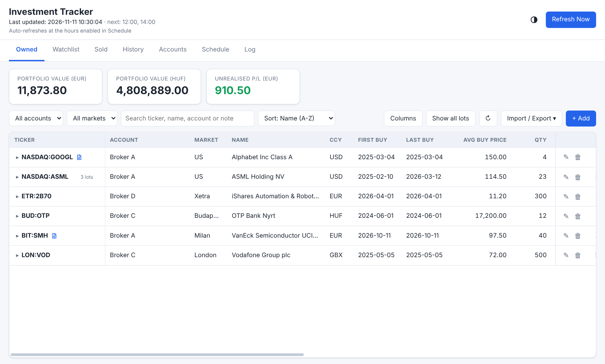
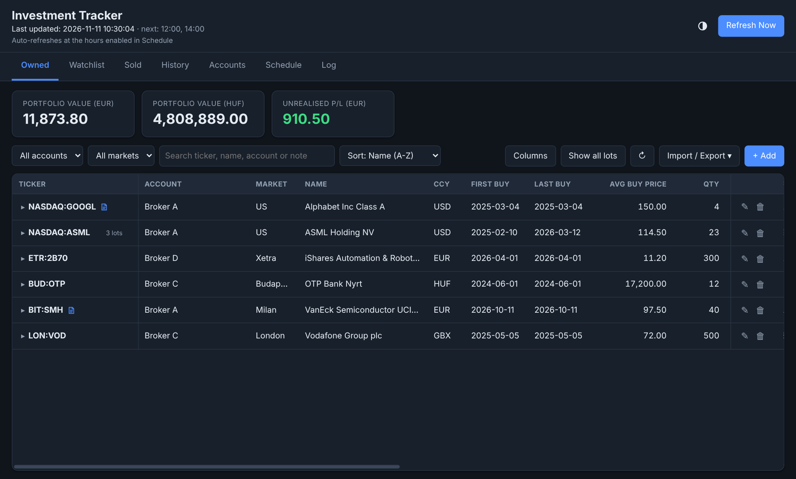
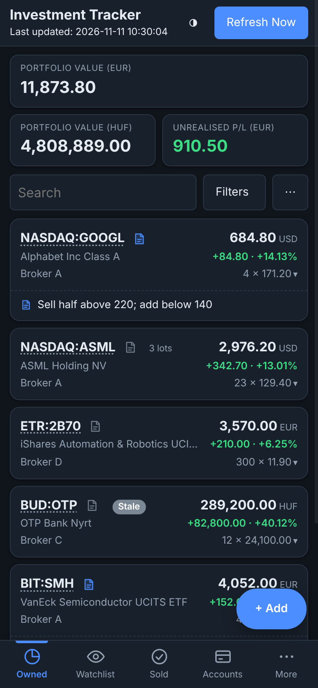

# Investment Tracker

A personal portfolio tracker that runs entirely inside **your own Google account**: a Google Sheet is the database, Google Apps Script is the backend, and a one-page web app (desktop and phone) is the interface. No server, no API key, no cost.

*The screenshots use made-up sample data.*

## What it does

- **Owned, Watchlist and Sold** lists with live prices (Google Finance first, Yahoo Finance as a fallback), profit and loss per position, and portfolio totals in EUR (and optionally HUF).
- **Several brokerage accounts**, **lots** (every purchase tracked on its own, and you choose which lots to sell), and optional **available cash** per account.
- **Bulk import** from pasted spreadsheet cells, an Edit dialog, **stock splits**, **CSV export** for tax time, and a daily **portfolio-value history** chart.
- **Notes** on Watchlist items, positions and sales, and research links for each ticker.
- A **phone layout** of the same page, **light and dark themes** (automatic, or switch with the button next to Refresh Now), and resizable, hideable columns.
- An optional **email** when prices stop refreshing.

## Install (about 20 minutes)

1. Create a blank Google Sheet, then **Extensions → Apps Script**.
2. Copy the 14 files from [`src/`](src) into the project (the guide says exactly how), and set your own `"timeZone"` in `appsscript.json`.
3. Run `setup` once, then deploy as a **Web app** (execute as *me*, access *only myself*).

The full step-by-step guide, with usage, troubleshooting and settings, is in **[docs/GUIDE.md](docs/GUIDE.md)**. For importing many holdings at once there is an Excel template with made-up sample rows, [`docs/import-template.xlsx`](docs/import-template.xlsx) (a [CSV version](docs/import-template.csv) too). Accounts named in the file are created by the import.

## Privacy and security

- Your data lives only in **your** spreadsheet. Nothing in this repository contains data, keys, sheet IDs or addresses; each person deploys their own copy.
- The web app is deployed with *Execute as: me* and *Who has access: only myself*. Keep it that way: a copy shared with "Anyone" would show your portfolio to anyone with the link.
- The script contacts Yahoo Finance with ticker symbols only (no personal data). Prices otherwise come from `GOOGLEFINANCE` inside your sheet.
- If you use `clasp`, never commit `.clasp.json` (it holds your script ID). It is already in `.gitignore`.

## Limitations

- **Single user**, one Google account.
- Totals are in **EUR** (fixed base currency) and optionally **HUF**; other currencies are converted to EUR. Set `showHuf` to FALSE to hide the HUF cards.
- The Yahoo Finance endpoint is unofficial and may change or throttle without notice, and its terms are for personal use. Google Finance data can be about 20 minutes late.
- Stock splits are applied by hand; dividends and fees are not part of the profit and loss figures.
- It was tested against a simulated spreadsheet and in a real browser, but not against every behaviour of Google's live services; the guide's section 9 lists what to confirm on your own account.

## Disclaimer

This is a personal bookkeeping tool, not financial advice. Prices may be delayed, wrong or missing. Check important figures against your broker's statements. The software is provided as is, without warranty (see [LICENSE](LICENSE)).

## License

[MIT](LICENSE)
